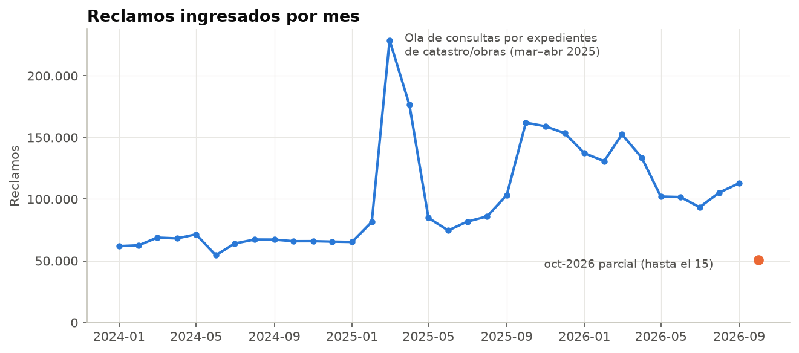
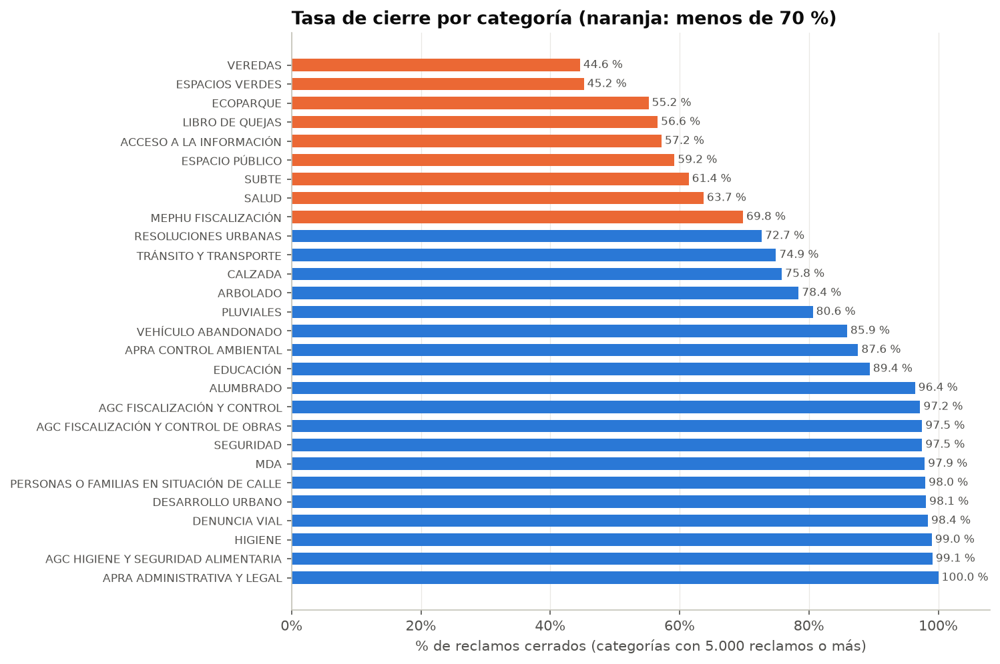
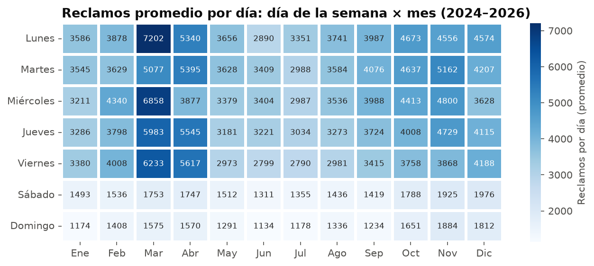
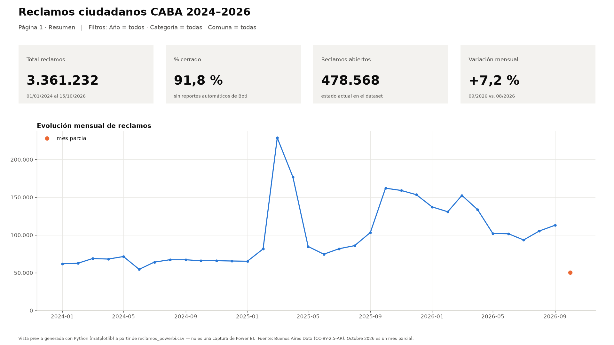
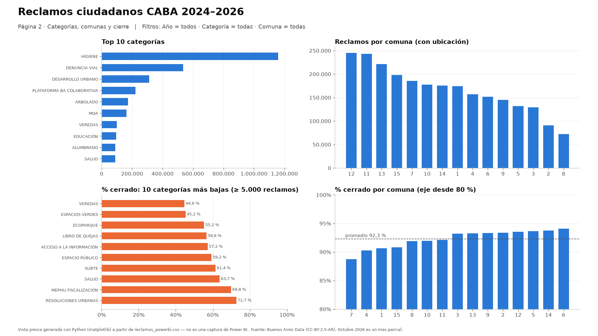

# Análisis de reclamos ciudadanos — Ciudad de Buenos Aires

Análisis de datos end-to-end de **3,36 millones de reclamos y solicitudes** que vecinos y vecinas hicieron a la
Ciudad de Buenos Aires entre enero de 2024 y octubre de 2026 (línea 147, chatbot Boti, web, app y sedes comunales).
Limpieza con **Python**, consultas con **SQL (DuckDB)**, análisis exploratorio en **Jupyter** y guía de dashboard en **Power BI**.



## El problema

Un área de atención ciudadana necesita saber **cuánta demanda entra, dónde se concentra, qué proporción se resuelve
y cuándo llega**, para decidir dónde poner recursos. Preguntas de negocio:

1. ¿Cuántos reclamos entran por mes y cómo evoluciona el volumen?
2. ¿Qué categorías y comunas concentran más reclamos?
3. ¿Qué tasa de cierre (% cerrado) tiene cada categoría?
4. ¿Qué tasa de cierre tiene cada comuna?
5. ¿Hay estacionalidad por día de la semana o por mes?

## Resultados principales

1. **Dos categorías explican la mitad de la demanda.** HIGIENE (34,5 %) y DENUNCIA VIAL (15,9 %) suman el 50,4 %
   del total. HIGIENE pasó de ~30.500 a ~46.500 reclamos por mes desde octubre de 2025 (+53 %).
2. **VEREDAS es el principal stock pendiente:** 100 mil reclamos y solo 44,6 % cerrados (más de 55 mil abiertos).
3. **Las comunas se parecen; la diferencia tiene causa concreta.** La tasa de cierre va de 88,7 % (Comuna 7) a
   94,1 % (Comuna 6). Las comunas 7 y 4, las más bajas, acumulan sus pendientes en veredas (36 % y 40 % de cierre).
4. **La demanda es de días hábiles:** un lunes promedio recibe 4.278 reclamos, el triple que un domingo (1.412).
5. **Hay olas puntuales que distorsionan los promedios:** ~237 mil consultas por expedientes de catastro en
   marzo–abril de 2025 y ~18 mil reportes automáticos de Boti por mes desde octubre de 2025.

**Recomendaciones:** plan de reparación de veredas con foco en las comunas 7 y 4, revisar la capacidad de higiene
urbana frente al aumento, reforzar equipos de lunes a miércoles y monitorear el volumen semanal por prestación
para detectar olas a tiempo.

| Tasa de cierre por categoría | Reclamos por día de la semana × mes |
|---|---|
|  |  |

El detalle, con todas las tablas y gráficos, está en [`notebooks/01_eda.ipynb`](notebooks/01_eda.ipynb).

## Datos

- **Fuente:** [Sistema Único de Atención Ciudadana / BA Colaborativa](https://data.buenosaires.gob.ar/dataset/sistema-unico-atencion-ciudadana) — Buenos Aires Data, Gobierno de la Ciudad de Buenos Aires.
- **Licencia:** [CC-BY-2.5-AR](https://creativecommons.org/licenses/by/2.5/ar/).
- **Período:** 01/01/2024 al 15/10/2026 (últimos 3 años; octubre 2026 es parcial). Un CSV por año, unos 650 MB en total.
  Los datos no se suben al repo: los descarga `src/download.py`.

**Calidad de datos — lo que encontré y cómo lo resolví:**

| Problema | Solución |
|---|---|
| Cada año tiene distinto separador, formato de fecha, formato de hora y nombre de columnas | Lectura y conversión por año antes de unir |
| En 2024 y 2025 el campo de minutos de la hora trae el **mes** (100 % de las filas) | Solo se usa la hora en punto |
| 2.362 cargas duplicadas (distinto número, misma dirección, trámite y momento) | Se eliminan |
| Mismo barrio o canal escrito distinto según el año (`BOCA` / `LA BOCA`, `APP BA 147` / `APP`) | Normalización de textos y mapeo |
| 26 % sin comuna (trámites sin dirección); 9 % en 2024 vs. 33 % en 2025 | Los análisis por comuna usan solo filas con ubicación |
| ~222 mil reportes automáticos de Boti que nunca se cierran | Excluidos de la tasa de cierre |
| **No hay fecha de cierre** | Se mide tasa de cierre en lugar de tiempo de resolución |

## Herramientas

- **Python 3.11+**: pandas (limpieza), pyarrow (parquet)
- **SQL**: DuckDB — CTEs, `CASE`, funciones de ventana (`LAG`, `RANK`, `SUM() OVER`)
- **Visualización**: matplotlib y seaborn
- **Jupyter** para el análisis y **Power BI** para el dashboard

## Cómo ejecutarlo

```bash
pip install -r requirements.txt
python src/download.py && python src/clean.py && python src/build_db.py
jupyter notebook notebooks/01_eda.ipynb
```

1. Instala las dependencias (recomendado dentro de un entorno virtual).
2. Descarga los CSV, los limpia (imprime un reporte de calidad) y carga la base DuckDB ejecutando las consultas de `sql/kpis.sql`.
3. Abre el notebook de análisis.

> La limpieza procesa ~3,4 millones de filas: se recomiendan al menos 8 GB de RAM.

## Estructura del repositorio

```
├── src/
│   ├── download.py     # descarga los CSV anuales y muestra un resumen
│   ├── clean.py        # limpieza, reporte de calidad, parquet + CSV para Power BI
│   ├── build_db.py     # carga a DuckDB y ejecuta las consultas
│   └── dashboard_preview.py  # vista previa del dashboard con matplotlib
├── sql/kpis.sql        # una consulta comentada por pregunta de negocio
├── notebooks/01_eda.ipynb
├── reports/figures/    # gráficos exportados
├── dashboard/README.md # guía paso a paso para Power BI (medidas DAX incluidas)
└── data/               # raw/ y processed/ (no versionados)
```

## Dashboard

Guía completa con las medidas DAX en [`dashboard/README.md`](dashboard/README.md).

> **Vista previa hecha con Python, no es una captura de Power BI.** Las dos imágenes de abajo las genera
> `src/dashboard_preview.py` con matplotlib a partir del mismo CSV y las mismas medidas que usa la guía, para mostrar
> el diseño del dashboard. Se van a reemplazar por las capturas del dashboard real en Power BI.

**Página 1 — Resumen** (KPIs y evolución mensual)



**Página 2 — Categorías, comunas y cierre**



<!-- Cuando estén las capturas de Power BI, reemplazar las imágenes de arriba por:


-->


## Qué aprendí / próximos pasos

- Los datos abiertos reales vienen con formatos que cambian entre años y errores de origen: perfilar cada archivo
  antes de unirlos evitó conclusiones equivocadas (por ejemplo, sobre la hora de ingreso).
- Un número sin contexto engaña: el pico de 2025 y la "tasa de cierre 0 %" de una categoría se explicaban por
  consultas puntuales y reportes automáticos, no por un problema operativo.
- **Próximos pasos:** conseguir la fecha de cierre para medir tiempos de resolución, sumar un mapa por barrio con las
  coordenadas y automatizar la actualización semestral del dataset.

---

**Nota sobre el desarrollo:** el planteo del análisis, la limpieza de datos, las consultas SQL y las conclusiones son de mi autoría. Usé Claude (IA) como asistente para subir el repositorio a GitHub y dejarlo funcionando, por eso figura como colaborador.

Autor: [cirogael](https://github.com/cirogael) · Datos: Gobierno de la Ciudad de Buenos Aires (CC-BY-2.5-AR)
